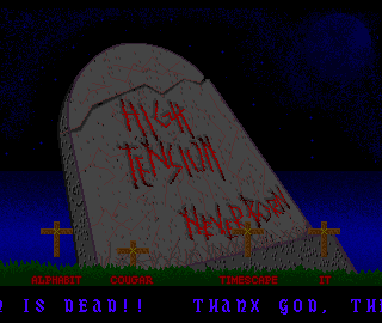
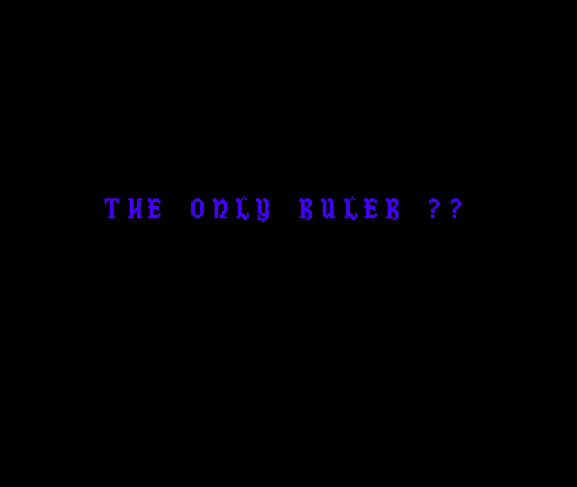

# Divina – High Tension… Never Born

An Amiga intro released by the Italian group **Divina** in **November 1990**. Coding and graphics are by **Sledge**, the scrolltext by **Storm**, **Dark Angel** and Sledge. It is a "celebration demo": Divina made it to mark the end of the rival Italian group **High Tension**. The screen shows a cracked tombstone with *HIGH TENSION… NEVER BORN* written on it in red. In front of it are four graves named **ALPHABIT**, **COUGAR**, **TIMESCAPE** and **IT**, and a gothic scroller runs at the bottom.

<p align="center">
  
  
</p>

The intro runs on an OCS Amiga 500 with Kickstart 1.3. It has two phases:

1. **Opening, about 20 seconds, silent.** The screen is black except for a fast scroller in the middle, which shows short taunts one at a time: "HIGH TENSION?", "THE ONLY RULER ??", "BAAH…!!", "HAW! HAW! HAW! HAW!", "DIVINA SAID: GAME OVER!".
2. **Main screen.** The 32-colour picture appears, the music starts, the scroller moves to the bottom and slows down to 1 pixel per frame. Its first word is "INTRODUCING". Each grave is tied to one audio channel: when that channel plays a new instrument note, the cross jumps up and then sinks back into the ground over 9 frames, like a VU meter.

The left mouse button returns to the CLI.

## Contents of the repository

| Path | What it is |
|---|---|
| [Divina-HighTensionNeverBorn](Divina-HighTensionNeverBorn) | the original executable, packed |
| [Divina-HighTensionNeverBorn.asm](Divina-HighTensionNeverBorn.asm) | IRA disassembly of the original executable (depacker + packed data) |
| [work/divina.asm](work/divina.asm) | **relocatable rebuild** of the whole intro, assembles with vasm |
| [work/Makefile](work/Makefile) | build and run targets (A500 / A600) |
| [work/unpacked_4fff0.asm](work/unpacked_4fff0.asm), [.cnf](work/unpacked_4fff0.cnf) | raw IRA disassembly of the unpacked image at `$4FFF0`, with the config that names code areas and labels |
| [work/decrunch.py](work/decrunch.py) | depacker in Python; recreates the unpacked image from the original file |
| [work/assets/](work/assets) | the extracted assets (see [Assets](#assets)) |
| [docs/screenshots/](docs/screenshots) | screenshots from the tests |

## Build and run

You need [vasm](http://sun.hasenbraten.de/vasm/) (`vasmm68k_mot`), `exe2adf` and FS-UAE.

```sh
cd work
make            # divina (AmigaDOS executable) + divina.adf (bootable disk)
make run        # FS-UAE: A500, KS 1.3, 512K chip + 512K slow
make run600     # FS-UAE: A600, KS 2.05, 1MB chip (stock)
```

To get the unpacked image back from the original file:

```sh
python3 work/decrunch.py Divina-HighTensionNeverBorn unpacked_4fff0.bin
```

## Testing

All tests were done in FS-UAE 3.1.66, booting `divina.adf` (the startup-sequence runs the intro).

| Machine | Result |
|---|---|
| **A600 stock**: 68000, ECS, KS 2.05 (37.299), 1MB chip, no fast RAM | rebuild with the fixes: **10 minutes without problems**. That is the 20 s opening plus almost two full loops of the song (4:52 each); the scrolltext also loops. Screenshots every 30 s, all different, so the intro never froze. Then the left mouse button: clean return to the AmigaDOS prompt, the shell still works, and running `divina` again from the same shell works |
| A600, same setup | original packed executable: black screen during the whole opening, then *Software Failure 8000 0004* about 20 s later, when the music starts |
| A600, same setup | rebuild **before** the fixes (byte-identical to the original): same black screen and same crash, every time |
| A500: 68000, OCS, KS 1.3 (34.5), 512K chip + 512K slow | rebuild with the fixes: 10 minutes without problems (screenshots every 30 s, all different), then a clean return to the AmigaDOS prompt with the left mouse button |

What goes wrong in the original on KS 2.05, and how the rebuild fixes it, is explained in [Bugs in the original and fixes](#bugs-in-the-original-and-fixes).

## The packed executable

The original file is 87,468 bytes. It has two hunks: a code hunk of `$555C` longwords, which holds a small depacker followed by the packed data, and a 4-byte BSS hunk that is never used. There are no relocations: the depacker uses PC-relative addressing only.

### Depacker

The depacker (`$32250`–`$32383` in [the disassembly](Divina-HighTensionNeverBorn.asm)) is followed by a 12-byte header:

| Offset | Value | Meaning |
|---|---|---|
| +0 | `$00040624` | not used by the depacker |
| +4 | `$0004FFF0` | destination address |
| +8 | `$00015430` | size of the packed stream (87,088 bytes) |

The packed stream comes straight after the header. The depacker reads it **backwards**, one longword at a time, starting from the end:

- the last longword is the unpacked size (`$30010` = 196,624 bytes);
- the one before it is the first bit buffer.

Bits are taken from the low end of `D0` with `LSR.L #1`. When `D0` becomes zero, the next longword is loaded and shifted with `ROXR.L #1` after `MOVE #$10,CCR` has set X. This puts a 1 in bit 31 as an end marker, so the depacker never needs a bit counter. The output is also written backwards, from `$4FFF0+$30010` = `$80000` down to `$4FFF0`. Each decoded literal byte is also written to `COLOR00`, which makes the screen flash while the intro unpacks.

The packed data is a sequence of literal runs and back-references (an LZ77 scheme). Each step reads a literal run and then a match:

**Literal run** (count read first, then 8 bits per byte):

| Code | Number of literal bytes |
|---|---|
| `000` | none |
| `001`–`110` | 1–6 |
| `111` `0` + 4 bits | 7–22 |
| `111` `1` + 10 bits | 1–1023; if the 10 bits are zero, an 18-bit count follows |

After the literals, if the output pointer has reached the start, the depacker jumps to `$4FFF0`.

**Match** (length code, then offset; the bytes are copied from `dest + offset`, one at a time, backwards):

| Code | Length | Offset |
|---|---|---|
| `00` | 2 | 8 bits |
| `01` | 3 | `1` → 8 bits, `0` → 14 bits |
| `10` | 4 | see below |
| `11` `00` / `01` | 5 / 6 | see below |
| `11` `10` + 2 bits | 7–10 | see below |
| `11` `11` + 8 bits | 1–255 (0 would copy 65,536 bytes) | see below |

For lengths 4 and up, the offset is: `0` → 16 bits; `1` `1` → 8 bits; `1` `0` → 12 bits.

The scheme is close to ByteKiller (backward stream, longword bit buffer with a marker bit, output written from the end) but the codes are different and there is no ByteKiller header or checksum. I could not identify the packer with certainty. [decrunch.py](work/decrunch.py) follows the 68000 code step by step; the stream ends exactly at offset 0 of the output, which confirms the decoding.

The depacker writes to `$4FFF0`–`$80000` **without allocating that memory**. On a 512K machine this is the top 320 KB of chip RAM, so the packed executable only works if nothing important lives there.

## Memory map of the unpacked image

| Address | Size | Content | Label in the rebuild |
|---|---|---|---|
| `$4FFF0` | 16 | `JMP $7C800` + padding | — |
| `$50000` | 74,996 | ProTracker module "castle" (M.K.) | `MtModule` |
| `$624F4` | | empty | |
| `$63800` | 5 × `$2800` | main picture, 320×256, 5 bitplanes | `Picture` |
| `$70000` | 5 × `$2800` | animation frames for the four crosses, same format | `Anim` |
| `$7C800` | ~2.8 KB | code, copper list, player variables | `Main` … |
| `$7D31C` | 1,494 | hidden Italian text, never used by the code | `UnusedText` |
| `$7DA00` | 2,225 | scrolltext | `ScrollText` |
| `$7E800` | 2,048 | font: 64 characters, 16×16, 1 bitplane | `Font` |
| `$7F000` | 42 × 16 | scroller buffer (plus empty space up to `$80000`) | `ScrollBuf` |

All graphics, samples and the copper list must be in chip RAM. In the rebuild everything is in one `CODE_C` section.

## How the intro works

### Start-up and exit

`Main` (`$7C800`):

1. `SysInit`: `Forbid()`, `OpenLibrary("graphics.library")`, saves `gb_copinit` (offset 38) to restore it at the end, turns sprite DMA off, writes its own copper list to `COP1LC`.
2. `IntInstall`: turns the audio filter off (`$BFE001` = `$02`), calls `mt_init`, saves the level 3 autovector at `$6C` and replaces it with `Level3Int`. It does not use `AddIntServer()`.
3. Busy loop on the left mouse button (`BTST #6,$BFE001`). All the work happens in the interrupt.
4. `IntRemove`: restores the vector, stops the audio (`mt_end`), turns the filter back on. Then it restores the system copper list, writes `DMACON`, calls `Permit()` and returns 0 to the CLI.

### The level 3 interrupt

`Level3Int` is the heart of the intro. It is called once per frame on vertical blank, and it:

1. waits until the beam reaches line `$20` (`CMPI.B #$20,$DFF006`);
2. counts frames in `FrameCount` up to `$400`. At frame 1024, about 20.5 s on PAL, it switches to the main screen (see below) and from then on runs the switch code again every frame, which is harmless;
3. if `AnimOn` is set, it advances the four cross animations (`Anim1Step`…`Anim4Step`);
4. moves the scroller (`ScrollBlit`) and, every `ScrollSpeed` frames, draws the next character (`NextChar`). While `ScrollPause` is not zero, it counts it down instead;
5. if `AnimOn` is set, it calls the music player `mt_music`;
6. jumps to the old system handler, with a `JMP (abs).L` whose address is written at start-up into the instruction itself (self-modifying code).

The music and the crosses only start with the main screen, so the opening is silent.

### Copper list and the two phases

The copper list (at `$7CA9E`) sets a standard PAL low-res window (`DIWSTRT $2C81`, `DIWSTOP $2CC1`, `DDFSTRT $38`, `DDFSTOP $D0`), the five bitplane pointers of `Picture`, and all 32 colours. Then it switches to a one-bitplane screen for the scroller:

| Entry | Opening | Main screen |
|---|---|---|
| `BPLCON0` (top) | `$0200`: no bitplanes, black | `$5200`: 5 bitplanes, the picture |
| `CopTopWait` | `$01FE,$0000` (copper no-op) | `$FFDF,$FFFE`: wait for line 255, so the next waits can reach lines beyond 255 |
| `CopScrWait` | wait line `$90`, middle of the screen | wait line `$11C` (284) |
| then | `BPLCON0 $1200`, `BPL1PT` = scroller buffer, modulo 2 | same |
| `CopEndWait` | wait line `$B0` | wait line `$12C` (300) |
| then | `BPLCON0 $0000`, end of list | same |

At frame 1024 the interrupt patches these four entries, which moves the scroller from the middle of a black screen to the area below the picture.

Palette (`COLOR00`–`COLOR31`): `$000 $40F $024 $020 $660 $420 $531 $030 $006 $007 $008 $007 $006 $004 $003 $002 $777 $666 $533 $444 $333 $111 $111 $323 $222 $333 $200 $400 $600 $800 $333 $323`. The scroller uses `COLOR01` = `$40F`, a blue-violet.

### The scroller

The scroller buffer is 336 pixels wide (21 words, 42 bytes per line) and 16 lines high. The display shows the first 320 pixels; the modulo of 2 skips the 16-pixel column on the right, which is hidden and holds the incoming character.

Each frame, `ScrollBlit` makes one blit of the whole buffer, from `ScrollBuf+2` to `ScrollBuf`, channels A→D, with an **A shift** taken from `ScrollCon0`. Reading from one word to the right and shifting right by *s* moves the picture left by 16 − *s* pixels:

| Phase | `BLTCON0` | Speed | New character every |
|---|---|---|---|
| Opening | `$49F0` (shift 4) | 12 px/frame | 1 frame |
| Main screen | `$F9F0` (shift 15) | 1 px/frame | 12 frames |

In both phases the characters are placed 12 pixels apart. `NextChar` copies the 16 words of the character with the CPU into the hidden column (`ScrollBuf+40`). Each copy overwrites the right 4 pixels of the previous character, so the glyphs are drawn within 12 pixels.

Control characters in the text:

| Byte | Effect |
|---|---|
| `@` | pause the scroller for `$90` frames (2.9 s) |
| `$0A` | skipped: the source text is split into lines |
| `$00` | restart from the beginning |

The font has 64 characters from space to `_` (only capital letters), 16×16 pixels, 32 bytes each, in a gothic style.

The opening is timed against the text. The taunts take 163 characters and 6 pauses of 144 frames, which fills almost exactly the 1024 frames of the opening. At the switch only the "I" of "INTRODUCING" has been drawn (in the hidden column), so "INTRODUCING" is the first word that scrolls in, slowly, under the picture.

### The four graves

`Anim` holds a second 320×256 picture (see [anim_frames.png](work/assets/anim_frames.png)). It has four rows of 64 lines, one per grave, and each row holds 10 copies of the grave, 32 pixels wide, with the cross a little lower each time. The intro uses the first 9.

`AnimNStep` copies the current frame into the picture with 5 blits (one per bitplane, `BLTCON0 $09F0`, 2 words × 64 lines, modulo `$24` on both sides), waits for the blitter after each one, then moves on to the next frame. After the 9th frame it stops, and the cross stays sunk.

The destinations are `Picture+$1A44`, `+$1A4C`, `+$1A58` and `+$1A60`: line 168, at x = 32, 96, 192 and 256, which is where the four graves are.

The link with the music is inside the player: when `mt_music` reads a note with an instrument number on a channel, it sets that channel's animation pointer back to frame 0 (code at `$7D066`–`$7D0B2`). Channel 1 drives ALPHABIT, channel 2 COUGAR, channel 3 TIMESCAPE, channel 4 IT.

### Music

The module is "castle", 31-sample ProTracker format (`M.K.`), 74,996 bytes. It has 6 samples, 28 patterns and 38 positions, and lasts about **4:52** at speed 6 before it loops. The scrolltext says it is *"MUZAK RIPPED FROM CASTLE MASTER"*. The sample names come from the standard SoundTracker sample disks: `ST-12:newwhist`, `ST-12:spacefunk`, `ST-20:chime`, `ST-02:perc-drytom`, `ST-22:human`, `ST-12:wsnare2`. The module only uses effects `1`, `2`, `C`, `E01` (filter off) and `F06`.

The player is a cut-down NoiseTracker-style replay (`mt_init`, `mt_music`, `mt_end`) that supports:

| Effect | Meaning |
|---|---|
| `0xy` | arpeggio |
| `1xx` / `2xx` | portamento up / down |
| `Axy` | volume slide |
| `Bxx` | position jump |
| `Cxx` | set volume |
| `Dxx` | pattern break |
| `E0x` | filter on/off |
| `Fxx` | speed (low nibble only, 1–15) |

Details of this player:

- **Speed** is stored inside an instruction: `Fxx` writes the new value into the immediate of `CMPI.W #6,mt_counter` (`mt_music+9`).
- **DMA wait**: after starting the notes it waits with a `DBF` loop of 500 iterations. This is fine on a 68000; it would be too short on a faster CPU.
- **Sample addresses**: `mt_init` computes the first sample address as `module + $438 + patterns × 1024`, while the patterns themselves start at `$43C`. So every sample pointer starts 4 bytes early. The player then clears the first longword of each sample, which actually clears the last 4 bytes of the previous sample, or of the last pattern for sample 1. In this module the last 4 bytes of the last pattern are already zero, so you cannot hear the difference.
- **No song-end handling**: when the position reaches the song length it goes back to position 0.

## Texts

### The scrolltext

[work/assets/scrolltext.txt](work/assets/scrolltext.txt). The main part, after "INTRODUCING", says:

- the intro was finished at **5:20 AM on 7 November 1990**, after a night spent "talking and smoking joints", by Storm, Sledge and Dark Angel;
- Divina released it "to celebrate the end of a never born team… **HIGH TENSION IS DEAD!!**", hoping that Alphabit won't start "a group saga like Zombies or Rambo" with "High Tension II";
- credits: **GFX and coding by Sledge with Storm support**, music ripped from *Castle Master*, scrolltext by Storm, Dark Angel and Sledge;
- a welcome to the new member **New Dream**;
- greetings from **Dark Angel**, the group's sysop, to Paradox, Red Sector, Classic, Zero Defects, Genesis, Switch, Gab!, I.B.B., Quartex, Resolution 101, Full Immersion Cracking Association, Phil Thrust, Angels, Razor 1911, TMARK-1 and Legend;
- the number of the group's BBS, and *"DIVINA… LEADING THE SCENE 199O!"*.

The digit zero is always written as the letter `O` ("199O", "5:2O"): the font has no `0`, its digit glyphs start at `1`.

### The hidden text

[work/assets/hidden_text.txt](work/assets/hidden_text.txt). Between the player and the scrolltext (`$7D31C`) there is a second text, in Italian, that the code never reads: you can only see it with a memory monitor or a hex editor. It is a series of insults aimed at High Tension, signed in turn by **Dark Angel**, **Storm** and **Sledge**. It mentions Cougar and a few other people by name, and it is aware of how it will be read: *"PERKE' VI STATE MONITORANDO LA NS PRODUCT??"* ("why are you looking at our production with a monitor??"). The four names on the graves are most likely members of High Tension: Alphabit and Cougar are both targeted in the two texts.

## Assets

All in [work/assets/](work/assets):

| File | Content |
|---|---|
| `castle.mod` | the music, ready to play in any ProTracker player |
| `picture.png` | the main picture, 320×256, 32 colours |
| `anim_frames.png` | the full animation sheet, 320×256 |
| `cross1_frames.png` … `cross4_frames.png` | the 9 frames used for each grave (32×64 each) |
| `font.png` | the 64 font characters, in the scroller colour, enlarged 2× |
| `palette.txt` | the 32 colours of the copper list |
| `scrolltext.txt` | the scrolltext (`@` = pause) |
| `hidden_text.txt` | the hidden Italian text |

## The relocatable rebuild

[work/divina.asm](work/divina.asm) is the whole unpacked image as vasm source, with no `ORG`:

- every absolute address is a label: `MtModule`, `Picture`, `Anim`, `Copper`, `ScrollText`, `Font`, `ScrollBuf`, the routines and the player variables. The comments keep the original address and opcode of each line;
- the bitplane pointers in the copper list cannot be relocated by the hunk loader (they are split into high and low words), so `FixCopper` fills them at start-up from a table. The call takes the 16 bytes of padding at the start of the image, so the rest of the layout is the same as the original;
- everything is in one `CODE_C` section;
- the self-modifying code is kept (song speed, `JMP` to the old vector). This is fine because the target is a 68000.

### How it was checked

Before any fix, I loaded the assembled executable at `$4FFF0` in a Python script, applied its 134 relocations and ran `FixCopper` on it. The result was identical to the unpacked image byte for byte, except for the first 16 bytes (the call to `FixCopper`).

### Bugs in the original and fixes

The original has several bugs. They are fixed in the rebuild and marked `fix:` in the source.

| Bug | Effect | Fix |
|---|---|---|
| `Level3Int` saves no registers. After the switch it trashes `D0`–`D4` and `A0`–`A6` | the level 3 interrupt can interrupt level 1 and 2 code of the system (software interrupts, CIA-A, the IDE of the A600), which then continues with wrong registers. Before the switch only `D0`/`D1`/`A0`/`A1` are touched and nothing visible happens. On A600/KS 2.05, both the original and the unfixed rebuild crash with *Software Failure 8000 0004* (illegal instruction) a few seconds after the music starts, every time. On A500/KS 1.3 there is less system activity at those levels and it usually survives | `MOVEM.L` save/restore around the handler |
| `Level3Int` runs the whole frame code for every level 3 interrupt (copper, blitter, vertical blank) | if blitter or copper interrupts are enabled, the music and the scroller run twice in one frame | the frame code only runs if `INTREQR` has `VERTB` set; any other source goes straight to the system handler |
| `MOVE.L #$00008380,$DFF096` | writes `$0000` to `DMACON` and `$8380` to `CLXCON`, so bitplane, copper and master DMA are never turned on. On KS 1.3 they are already on, because the boot CLI screen is open. On KS 2.05, when the intro starts from the startup-sequence, the shell window is not open yet and bitplane DMA is off: **the whole opening is a black screen** | `MOVE.W #$8380` |
| `MOVE.B #$FF,$DFF096` on exit | a byte write to a custom register is seen as `$FFFF`: it turns on every DMA channel and `BLTPRI` ("blitter nasty") | `MOVE.W #$8020` (only turns sprite DMA back on) |
| `OpenLibrary` with `D0` not set | the version asked for is whatever `D0` held at start | `MOVEQ #0,D0` |
| `graphics.library` never closed | the open count stays one too high | `CloseLibrary` on exit |

These are left as in the original: the 4-byte sample offset in `mt_init` (inaudible with this module), the 500-iteration DMA wait, and the busy wait for line `$20` inside the interrupt.

## Tools

- [IRA](http://aminet.net/package/dev/asm/ira) 2.11 for the disassembly, with the config in [work/unpacked_4fff0.cnf](work/unpacked_4fff0.cnf)
- [vasm](http://sun.hasenbraten.de/vasm/) and `exe2adf` for the build
- FS-UAE 3.1.66 for the tests
- Python 3 + Pillow for the depacker and the asset extraction
